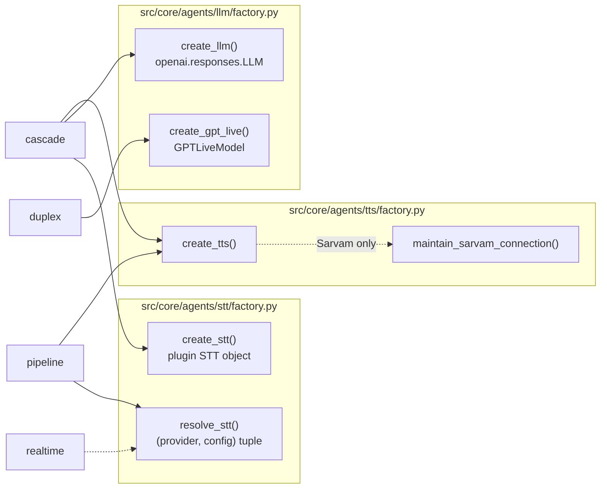

# Speech and LLM stages

What each stage offers a user (providers, config keys, defaults, validation) is in the public
[Cascade](../../docs/concepts/cascade.md) page and [Models & Providers](../../docs/reference/models.md).
This page explains how the factories build each stage, how cascade's turn detection is wired, and
how usage is metered per stage.

How `entrypoint()` picks a branch and builds the session around these stages is in
[Agent session](agent-session.md).

## Which factory runs in which mode



`pipeline` and `realtime` build their `RealtimeModel` inline in `session.py`, because that model
also owns STT (and in realtime, TTS); there is nothing to factor out. Every factory returns `None`
on a config error after logging why, and catches plugin constructor exceptions, so a bad row ends
the job cleanly instead of escaping `entrypoint()` as a traceback.

## STT

### Two STT resolvers

Do not mix them up.

- **`resolve_stt(assistant) -> (provider, config)`** serves the `pipeline` parallel tap. Unset
  means `sarvam`. `openai` collapses to `native` with no warning (same vendor, same
  `gpt-4o-mini-transcribe`, one connection fewer; it also keeps pre-migration rows, where
  `openai` meant native, working). For a plugin provider with neither `assistant_stt_config.api_key`
  nor the system key, it logs a warning and returns `("native", {})`: selecting a plugin STT
  disables the model's own transcription, so an unauthenticated plugin would leave the call with
  no user transcripts. `cartesia`, `deepgram` and `elevenlabs` are returned as-is; the pipeline
  branch in `session.py` logs that they are cascade-only and uses native transcription.
- **`create_stt(assistant, usage=None)`** builds a real plugin STT for cascade, where STT is a
  first-class session stage. `native` has no meaning here (no realtime model), and an unknown
  value logs and returns `None`. A missing key returns `None` too and the cascade job **aborts**;
  it never falls back to another provider. The API refuses such rows up front (gate in
  `src/api/validation/assistant_guard.py`), so only rows written before that check, or edited
  outside the API, reach this.

System keys, each overridden by `assistant_stt_config.api_key`:

| Provider | System key | Note |
|---|---|---|
| `sarvam` | `SARVAM_API_KEY` | also the Sarvam TTS key |
| `cartesia` | `CARTESIA_API_KEY` | |
| `deepgram` | `DEEPGRAM_API_KEY` | |
| `elevenlabs` | `ELEVENLABS_API_KEY` | also the ElevenLabs TTS key |
| `openai` | `OPENAI_API_KEY` | also the cascade LLM key |

### Per-provider mechanics in `create_stt`

- **sarvam.** Returns `MeteredSarvamSTT` (not plain `sarvam.STT`, see
  [metering](#per-stage-usage-metering)) with `sample_rate=16000`. `mode` and `language` go through
  `validate_sarvam_mode` / `validate_sarvam_language` (`src/core/agents/stt/lang.py`) because the
  plugin **raises** on a code its model does not speak. `preferred_languages` is not wired in:
  auto-detect already covers it, and pinning would hurt a caller who switches.
- **cartesia.** `model` is pinned to `ink-whisper` in the factory instead of left to the plugin
  default, because that default became the English-only `ink-2` (in `livekit-agents` 1.5.15).
  Language validated, defaulting to `en`; Cartesia cannot auto-detect.
- **deepgram.** Two plugin classes behind one name, and neither validates the model, so the
  factory dispatches on the name: `flux*` builds `deepgram.STTv2` (`/listen/v2`), everything else
  `deepgram.STT` (`/listen/v1`). On flux, `language` becomes `language_hint=[code]` (a list, since
  a bare string reaches the wire as a JSON string) and only on `flux-general-multi`; `multi` is a
  v1 sentinel and is not sent; `enable_diarization` is logged and ignored. On nova, an unpinned
  language is `multi` for `_DEEPGRAM_AUTODETECT_MODELS` (`nova-3`, `flux-general-multi`) and
  `en-US` otherwise. `keyterm` is passed only when set.
- **elevenlabs.** `language_code` is validated as ISO 639-3; a BCP-47 code would close the socket
  with `1008 invalid_request`. After construction the factory writes the raw code back to
  `stt._opts.language_code`, because the plugin wraps it in `LanguageCode`, which normalises
  `hin` to `hi`, the ISO 639-1 form Scribe rejects. Drop that line once the plugin stops
  normalising.
- **openai.** `gpt-realtime-whisper*` logs and returns `None`: it has no server-side endpointing,
  so the plugin wants a `livekit-plugins-silero` VAD, which is not installed (the session's
  `inference.VAD` cannot be handed to an STT plugin); constructing it would raise `ImportError` at
  job start. `detect_language` is turned on whenever no valid `language` is pinned, because the
  plugin's own default is a hardcoded `en`. `use_realtime` defaults to `True`, inverting the
  plugin's batch default; `False` with a model outside `OPENAI_STT_DURATION_BILLED_MODELS`
  (`src/core/model_support/speech.py`, i.e. `whisper-1`) is forced back to `True` with a warning,
  because the batch path discards the server's token usage and the call would price to zero. The
  API refuses that pairing; this override is for rows stored before the gate.

## LLM (cascade): `create_llm`

`create_llm(assistant, *, has_tools=False)` builds `openai.responses.LLM`, the recommended surface
for the direct OpenAI API (cheaper than chat completions, same `@function_tool` contract).
`openai.LLM` remains the path for OpenAI-compatible third-party endpoints, which this platform does
not use. Model defaults to `DEFAULT_CASCADE_MODEL` (`gpt-4.1`).

- **Allowlist.** `CASCADE_MODELS` (re-exported to the API as `OPENAI_CASCADE_MODELS` in
  `src/api/models/api_schemas/config/llm_config.py`) is enforced by `validate_mode_config`. At call
  time an off-list model is **not** refused (the call is already connected); it logs a warning
  pointing at `scripts/audit_assistant_models.py`, because a retired id makes OpenAI 400 every
  turn with an error frame that names nothing. `REALTIME_MODELS` and `GEMINI_LIVE_MODELS` are
  separate lists because they talk to different APIs.
- **Knob forwarding.** A knob is passed only when set in config (non-None; truthy for strings),
  so omitted knobs keep the SDK default. They map onto `openai.responses.LLM` constructor args
  (the Responses API surface, not LiveKit Inference `extra_kwargs`): `temperature`,
  `max_output_tokens`, `service_tier`, `verbosity`, `tool_choice`, `parallel_tool_calls`, and
  `reasoning=Reasoning(effort=...)`.
- **Model-gated knobs.** `temperature`, `verbosity` and `reasoning_effort` pass through
  `keep()`, which asks `unsupported_knob_reason(model, knob, has_tools=...)`
  (`src/core/model_support/capabilities.py`) and drops the knob with a warning when the model
  cannot read it. Without this, the plugin raises a non-retryable `APIStatusError` inside
  `_llm_inference_task` on every turn, and over the WebSocket the only text is `There was an
  issue with your request. Please check your inputs and try again`. Membership is spelled out per
  model (`REASONING_MODELS`, `CHAT_MODELS`), never matched by prefix: the retired
  `gpt-5.x-chat-latest` aliases were gpt-5 generation (read `text.verbosity`) yet chat models
  (`temperature` yes, `reasoning_effort` no). `gpt-6-luna` / `gpt-6-sol` are in
  `REASONING_MODELS`, and the plugin injects no effort for them.
- **Injected reasoning.** `openai.responses.LLM.__init__` inserts its own `Reasoning` for the gpt-5
  models it believes support one, even with an empty config. On `REASONING_TOOL_INCOMPATIBLE`
  (`gpt-5.2`, `gpt-5.4`, `gpt-5.4-mini`) that is a 400 once tools are attached, and the SDK's own
  guard never fires on this path: the Responses plugin calls `drop_unsupported_params` without
  `tools`, and it filters the key `reasoning_effort` while the payload key is `reasoning`. So when
  `has_tools` and no explicit effort was sent, the factory sets `llm._opts.reasoning = NOT_GIVEN`
  after construction. `session.py` passes `has_tools=bool(tools)` from the complete list (DB tools
  plus `end_call`). Delete once the plugin fixes either half; covered by
  `tests/test_cascade_config.py`.
- **Log line.** Every build logs `Cascade LLM built | assistant=… | model=… | has_tools=… |
  knobs=…` (never the key) plus the `scripts/replay_cascade_request.py <id> --bisect` command,
  since this line is what a Responses 400 is read against.

At create/update, `unavailable_model_reason` and `rejected_config_reason`
(`src/core/model_support/openai_live.py`) also ask OpenAI whether it serves the model and accepts
the exact request (one 16-token probe). Details: [Validation and model support](validation-and-models.md).

`create_gpt_live` (duplex) shares `unsupported_knob_reason`; it is described in
[Agent session](agent-session.md#duplex-build-create_gpt_live).

## TTS: `create_tts`

The same four providers serve `pipeline` and `cascade`; `create_tts` is called only when
`not speaks_own_audio and not is_text_only`, and `tts.prewarm()` runs when the plugin has it. Keys
are resolved up front by `_resolve_api_key` (config `api_key`, else the variable in
`_TTS_ENV_KEYS`), so a missing key returns `None` instead of raising out of a plugin constructor
(ElevenLabs does raise).

- **cartesia**: `cartesia.TTS(model="sonic-3", ...)`, pinned with no config field; `sonic-3.5`
  exists only on the Cloud gateway. `speed` must be a float on `sonic-3`.
- **sarvam**: `sarvam.TTS` on `tts_config.model` or `DEFAULT_SARVAM_TTS_MODEL`; the speaker is
  checked against that model's roster first (`validate_sarvam_speaker`) because the plugin raises
  on a speaker from another generation. An IN22 language on a model other than `bulbul:v4-flash`
  falls back to `en-IN`. `min_buffer_size=30`, `max_chunk_length=50`.
- **elevenlabs**: `ElevenLabsNonStreamingTTS` (`src/services/elevenlabs/v3_nonstream.py`; `eleven_v3`
  has no WebSocket API). With no `voice_settings`, pass `NOT_GIVEN`, never `None`: the client
  treats `None` as set and `dataclasses.asdict(None)` crashes on first synthesis. Settings in
  `ELEVENLABS_UNREAD_SETTINGS` for the model are dropped with a warning.
- **mistral**: `MistralTTS` (`src/services/mistral/tts.py`), model `voxtral-mini-tts-2603`.

### Sarvam TTS keepalive

Sarvam TTS keeps a WebSocket pool (`ConnectionPool`, `max_session_duration=3600`), but the Sarvam
server closes an idle connection after about 5 s. Without help, every turn after a longer gap
paid a full reconnect and session handshake before the first audio frame: 300–800 ms.

`session.py` spawns `maintain_sarvam_connection(tts, _sarvam_stop)` for the call's lifetime right
after the participant joins, when `isinstance(tts, sarvam_plugin.TTS)`. It:

1. forces a fresh connection at call start (`tts._pool.invalidate()`, then `get()` and `put()`);
2. wakes every 3 s: **skips** the ping when `current_ws not in tts._pool._available` (TTS is using
   it), **reconnects** when `current_ws.closed` or a ping fails, otherwise **pings** to reset the
   server's idle timer;
3. exits when `_sarvam_stop` is set at teardown.

Result: the reconnect log line appears once per call instead of once per turn.

## Turn detection

Cascade has no realtime model and therefore no server-side VAD, so the session does endpointing
and interruption itself:

```python
AgentSession(
    stt=cascade_stt,
    llm=llm,
    tts=tts,
    vad=inference.VAD(model="silero", min_silence_duration=0.4),
    use_tts_aligned_transcript=True,
    aec_warmup_duration=1.0,
    turn_handling=TurnHandlingOptions(
        turn_detection=inference.TurnDetector(version="v1-mini"),
        endpointing={"mode": "dynamic", "min_delay": 0.3, "max_delay": 1.0},
        interruption={"mode": "vad", "min_duration": 0.5,
                      "false_interruption_timeout": 2.0,
                      "resume_false_interruption": True},
    ),
)
```

Everything runs locally; this is a self-hosted deployment.

- `inference.VAD(model="silero")` is an in-process native binding shipped in
  `livekit-local-inference`, a core SDK dependency: no key, no network call, nothing to prewarm.
  `min_silence_duration` is raised from the `0.25` default to clear the turn detector's `0.25`
  floor with margin.
- `inference.TurnDetector(version="v1-mini")` is an audio end-of-utterance model whose weights ship
  inside the wheel. The version is **pinned**: unpinned, the SDK tries the Cloud-only `v1` first
  whenever `LIVEKIT_DEV_MODE` is set, then falls back with a warning. 14 languages, including
  Hindi.
- `interruption={"mode": "vad"}`: `adaptive` is Cloud-only, and `_resolve_interruption_detection`
  disables it in production with no local fallback.

Unlike `pipeline`, these interruption knobs are live: no realtime-model VAD short-circuits them.

`SpeechGate` already runs a vendored Silero ONNX over the same audio for noise gating, so a cascade
call runs VAD twice (once to gate noise upstream, once to endpoint). Correct, but it costs worker
CPU.

Duplex uses the same `inference.VAD` only for barge-in, not for turns. `pipeline` uses
`turn_detection="realtime_llm"`.

### Cascade-specific runtime paths

- **Pre-answer window.** Pipeline switches the realtime model's server VAD off while waiting for an
  Exotel answer; cascade has no such model, so it blanks the input through `SpeechGate.muted`
  instead. See [Agent session](agent-session.md#greeting-path).
- **`end_call`.** Skips the `speech_created` wait; see
  [Agent session](agent-session.md#end-of-call).
- **Transcripts.** Written once via `conversation_item_added`; the Sarvam tap never starts.
- **Not used:** the Sarvam tap, `turn_detection="realtime_llm"`, `input_audio_transcription`,
  `build_native_stt_prompt` and `input_audio_noise_reduction` (all Realtime API parameters).
- **Text-only.** `text_only: true` takes the no-audio branch: no STT, TTS or VAD is constructed
  (`AgentSession(llm=llm)`).

## Per-stage usage metering

No collector is wired by hand: the session aggregates plugin metrics and exposes them on
`session.usage`, which `summarize_usage(session, extra_usage=())` in `src/core/agents/usage.py`
reads once at teardown (and on the periodic flush). It splits entries by type (`llm_usage`,
`tts_usage`, `stt_usage`) and sums them into flat `UsageRecord` fields; `model_usage` is the full
per-`(provider, model)` dump with `normalize_provider` applied, and is what pricing reads (the flat
fields sum across a mid-call model swap). It never raises: on failure it degrades to zeros.
Everything is in-process; no Cloud call is involved. The record lands in the `usage_records`
collection.

Three sources the SDK collector cannot see, or sees wrongly, are measured by us:

| Source | Mode | Mechanism |
|---|---|---|
| Sarvam STT stage | cascade | `create_stt` stamps `CascadeSttUsage` (provider, model). `DynamicAssistant.stt_node` sums `frame.duration` of every frame on its way to the STT. `MeteredSarvamSTT.emit` swallows the plugin's own `STTMetrics` (built from a server `audio_duration` that is missing on some responses and absent on empty transcripts) so the record has one entry, not two; it also reports `provider` as lowercase `sarvam`. Other cascade providers count their own frames, or (OpenAI) report billing tokens, and are used as they come. |
| Sarvam parallel tap | pipeline | `SttUsage` summed in the tap's frame pump, passed as `extra_usage`. |
| OpenAI realtime transcription | pipeline (native), realtime | The plugin's handler for `conversation.item.input_audio_transcription.completed` keeps the text and drops `usage`. `MeteredRealtimeModel.session()` subscribes `NativeSttUsage.observe` to the public raw event stream `openai_server_event_received`, producing `NativeSttModelUsage` with the audio/text input split (`stt_input_audio_tokens`, `stt_input_text_tokens`). |

Gemini Live reports no transcription usage, and none is missing: input audio is inside its prompt
tokens. GPT-Live reports `session_duration`, folded into `llm_session_duration`.

Overriding `stt_node` disables the SDK's STT-pipeline reuse across agent handoffs; this runtime
never hands off, so it costs nothing today.

Public field list: [Usage accounting](../../docs/reference/usage-accounting.md). Pricing:
[Usage and pricing](usage-and-pricing.md).

## Where in the code

| What | File | Symbol |
|---|---|---|
| Pipeline tap resolver | `src/core/agents/stt/factory.py` | `resolve_stt` |
| Cascade STT | `src/core/agents/stt/factory.py` | `create_stt`, `_DEEPGRAM_AUTODETECT_MODELS` |
| Language validation | `src/core/agents/stt/lang.py` | `validate_language`, `validate_sarvam_language`, `validate_sarvam_mode`, `validate_sarvam_speaker` |
| Cascade Sarvam metering | `src/core/agents/stt/cascade_usage.py` | `CascadeSttUsage`, `MeteredSarvamSTT` |
| Frame counting | `src/core/agents/dynamic_assistant.py` | `DynamicAssistant.stt_node` |
| Native transcription metering | `src/core/agents/stt/native_usage.py` | `NativeSttUsage`, `NativeSttModelUsage`, `MeteredRealtimeModel` |
| Cascade LLM | `src/core/agents/llm/factory.py` | `create_llm` |
| Knob rules, model sets | `src/core/model_support/capabilities.py` | `unsupported_knob_reason`, `CASCADE_MODELS`, `REASONING_MODELS`, `CHAT_MODELS`, `REASONING_TOOL_INCOMPATIBLE`, `PLUGIN_INJECTS_REASONING` |
| OpenAI STT billing set | `src/core/model_support/speech.py` | `OPENAI_STT_DURATION_BILLED_MODELS` |
| TTS | `src/core/agents/tts/factory.py` | `create_tts`, `_resolve_api_key`, `maintain_sarvam_connection` |
| Session construction, turn detection | `src/core/agents/session.py` | `entrypoint` |
| Usage folding | `src/core/agents/usage.py` | `summarize_usage`, `normalize_provider` |
| Built-in prompts | `src/core/agents/prompts.py` | `compose_instructions`, `speech_output_rules`, `ending_the_call`, `backchannel_system` |

## Built-in prompts

Every prompt the worker writes itself lives in `src/core/agents/prompts.py` as top-level snake_case XML tags with Markdown inside: the tag names the section, the Markdown carries the rules. Nothing sits outside a tag, and there are no Markdown headings, because the tag already is the heading. A new built-in prompt follows the same shape and gets a test in `tests/test_builtin_prompts.py`.

The agent's instructions are assembled in a fixed order by `compose_instructions`: the operator's stored prompt in `<assistant_prompt>` (left out when empty), then `<ending_the_call>` when the end-call tool is on, then `<speech_output_rules>`. `session.py` composes the first two once and hands the result to both `DynamicAssistant` (which appends `<speech_output_rules>`) and the Gemini realtime model; it no longer appends the end-call section to `assistant.assistant_prompt`, so the stored text stays exactly as the operator wrote it.

Values the operator writes (the stored prompt, a start instruction) and values inserted at run time (the avoid list, the goodbye message) go in raw and are not escaped. The operator already controls the whole prompt, and escaping would change what the model reads. The silence re-prompt sentence and the farewell sentence are spoken to the caller, not prompts, and are not wrapped.

The greeting instruction is wrapped at the point it goes to the model (`greeting_instruction`). `DynamicAssistant.start_instruction` stays the plain text, because the silence watchdog records it as the assistant's last message.
